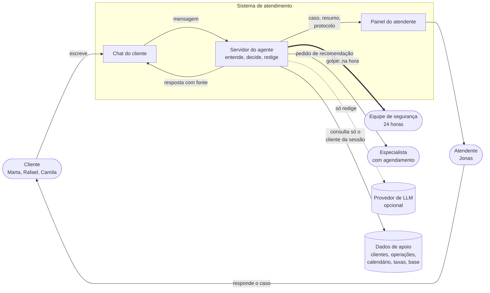

# Contexto do sistema

Quem fala com o agente de atendimento da Caqui, o que ele consulta e quem recebe os casos que ele não resolve.

Linhas pontilhadas são opcionais: sem LLM o servidor redige com templates. O cliente nunca vê dado de outro cliente.

Referenciado em `../JORNADA_DO_USUARIO.pdf` (contexto) e `bdd/entrega-ao-humano.feature`.
