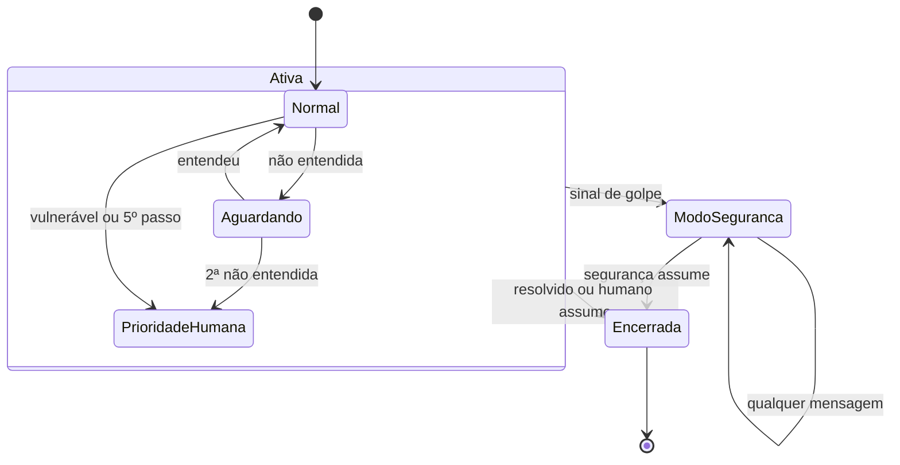

# Estados da sessão

O que a sessão guarda entre mensagens. O modo segurança trava até haver humano; a vulnerabilidade persiste.

Contadores: passos (máximo 5), mensagens sem entendimento (2 levam a humano), retenção já oferecida e última operação ou produto citados.

Referenciado em `../JORNADA_DO_USUARIO.pdf` (ciclo da sessão) e `bdd/sessao.feature`.
