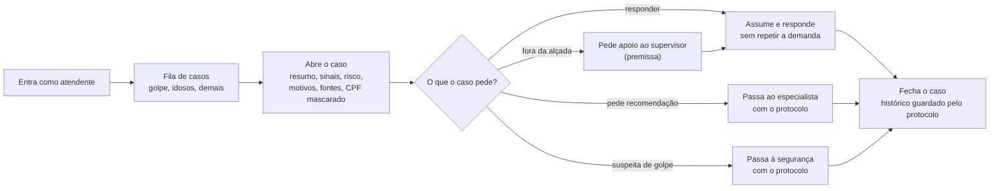

# Fluxo: o atendente no painel

O que o Jonas faz do momento em que entra até fechar o caso. O resumo e os motivos vêm do código; ele não pergunta de novo o que o cliente já contou.

Fora do horário o caso não aparece para o atendente: fica registrado com protocolo e entra na fila às 8h (ver `fluxo-horario.md`). Golpe é atendido pela segurança a qualquer hora. Reclamação mantém o prazo de até 7 dias corridos (KB-026).

Referenciado em `../JORNADA_DO_USUARIO.pdf` (fluxo do atendente) e `bdd/painel-do-atendente.feature`.
