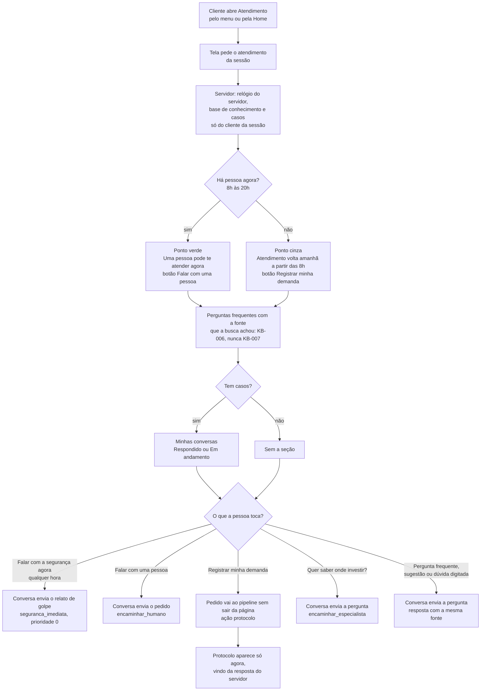

# Fluxo: Atendimento do cliente

Uma página, dois estados. O servidor monta tudo em `GET /api/chat/{sessaoId}/atendimento` com funções puras de `server/domain/support-view.ts`; o estado sai do relógio do servidor (`pipeline.agora()`), nunca do navegador. Cada botão só envia uma frase de `app/utils/pedidos.ts` à conversa que já existe, e o pipeline decide a ação.

O horário ("das 8h às 20h") e o retorno saem das mesmas constantes que decidem se há pessoa agora (D4, D13).

Referenciado em `../JORNADA_DO_USUARIO.pdf` (Atendimento do cliente) e `bdd/atendimento.feature`.
