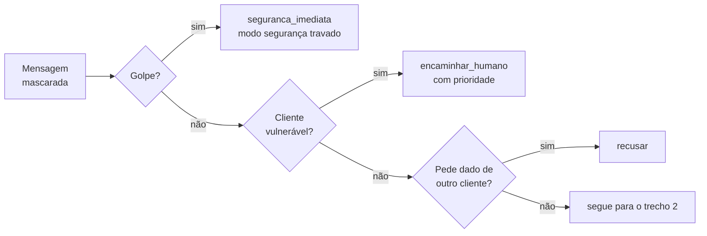
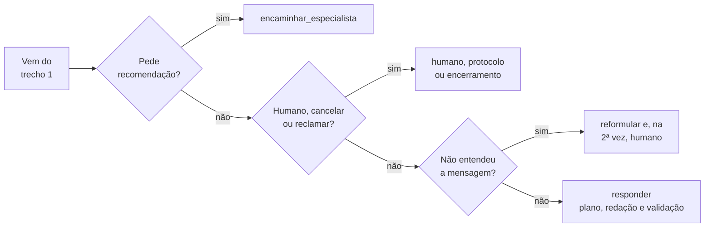

# Fluxo de uma mensagem: a política de decisão

Depois de mascarar o texto e extrair os sinais, a política escolhe a ação pela ordem fixa abaixo, em dois trechos. É uma função pura sobre sinais, sessão, relógio e cliente: não lê texto nem rede.

Trecho 1: sinais de risco.

Trecho 2: pedidos do cliente.

Cada ação gera protocolo e, quando vai a uma pessoa, entrega o caso com resumo. Injeção de papel ("você agora é...") é neutralizada como texto e não decide a ação sozinha.

Referenciado em `../JORNADA_DO_USUARIO.pdf` (anatomia de uma mensagem) e `bdd/prioridade-de-sinais.feature`.
