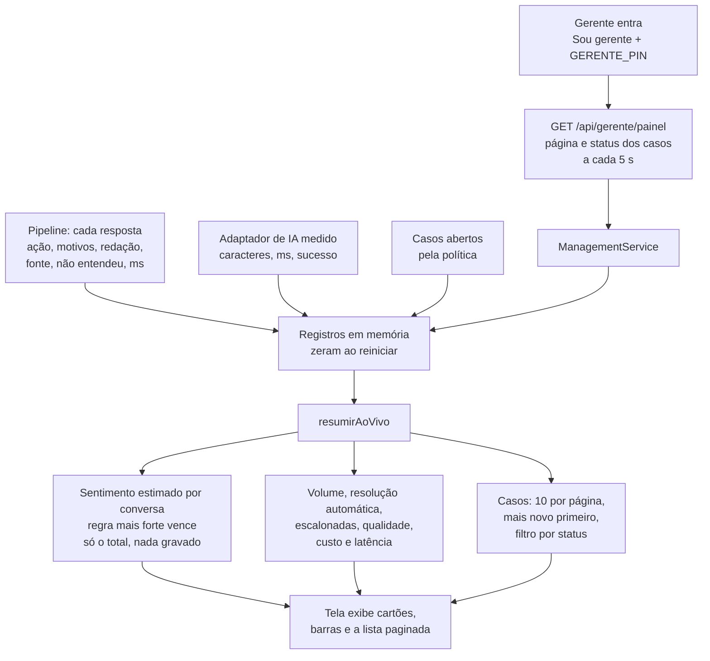

# Fluxo: painel do gerente

De onde vem cada número do painel. Tudo sai do que o pipeline e o adaptador de IA registram em memória desde que o servidor subiu. As contas são funções puras de `server/domain/management-metrics.ts`; a tela só exibe (D19).

O painel nunca recebe o texto da conversa nem o CPF: só contagens, ações, motivos e protocolos. Custo é estimativa (cerca de 4 caracteres por token, preço do `.env`).

Referenciado em `bdd/painel-do-gerente.feature`.
