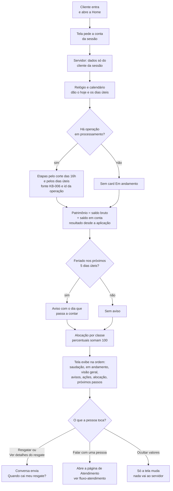

# Fluxo: Home do cliente

O que a Home mostra e de onde cada bloco vem. O servidor monta tudo em `GET /api/chat/{sessaoId}/conta` com funções puras de `server/domain/account-view.ts`; a tela só exibe e envia intenção para a conversa.

A data de cada etapa é a mesma que a Kaki responde na conversa: as duas saem de `calcularLiquidacao` com o mesmo relógio (D8, D12).

Referenciado em `../JORNADA_DO_USUARIO.pdf` (Home do cliente) e `bdd/home.feature`.
