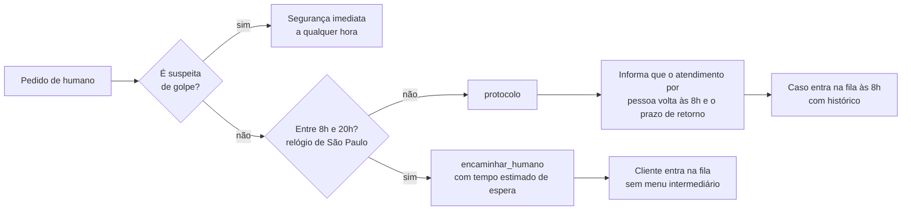

# Fluxo: horário de atendimento

Humano das 8h às 20h, todos os dias. Fora disso, protocolo e prazo de retorno. A segurança atende a qualquer hora.

O relógio é injetável: em testes e na demonstração o horário é informado.

Referenciado em `../JORNADA_DO_USUARIO.pdf` (horário de atendimento) e `bdd/horario-de-atendimento.feature`.
