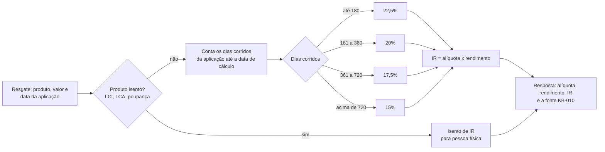

# Fluxo: imposto de renda na renda fixa

O imposto incide só sobre o rendimento, pela faixa dos dias corridos desde a aplicação.

A alíquota nunca incide sobre o valor total do resgate.

Referenciado em `../JORNADA_DO_USUARIO.pdf` (liquidação e IR) e `bdd/imposto-de-renda.feature`.
