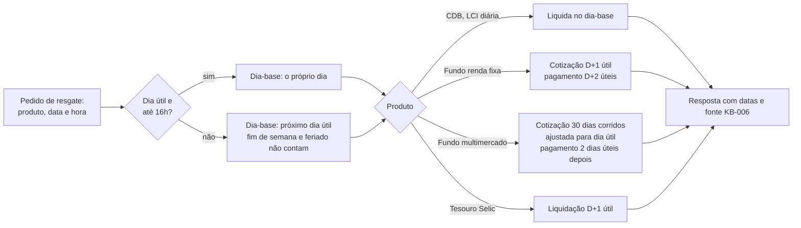

# Fluxo: liquidação de resgate

Como a data de pagamento é calculada pelo calendário da Caqui. Nunca é lida da planilha de operações.

Exemplo do case: pedido na sexta 30/10 às 17h, feriado na segunda 02/11, fundo de renda fixa: dia-base 03/11, cotização 04/11, pagamento 05/11.

Referenciado em `../JORNADA_DO_USUARIO.pdf` (liquidação e IR) e `bdd/liquidacao.feature`.
