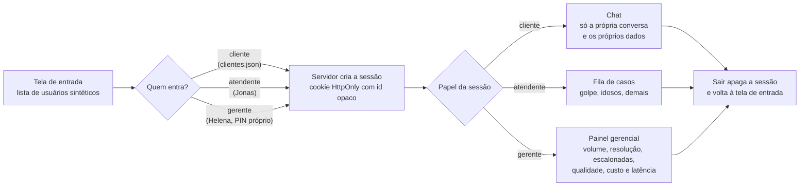

# Fluxo: login simulado e papéis

O app tem três visões: a do cliente (chat), a do suporte (fila de casos) e a do gerente (painel gerencial, D19). Não há senha: a tela de entrada lista usuários dos dados sintéticos e o servidor guarda a sessão, como no desafio-tecnico. O papel da sessão decide a visão e filtra tudo no servidor.

Segurança e especialista atendem pelos mesmos casos da fila; a distinção entre eles é do caso, não de uma tela própria (premissa a confirmar na SPEC).

Referenciado em `../JORNADA_DO_USUARIO.pdf` (login e papéis) e `bdd/acesso-e-papeis.feature`.
