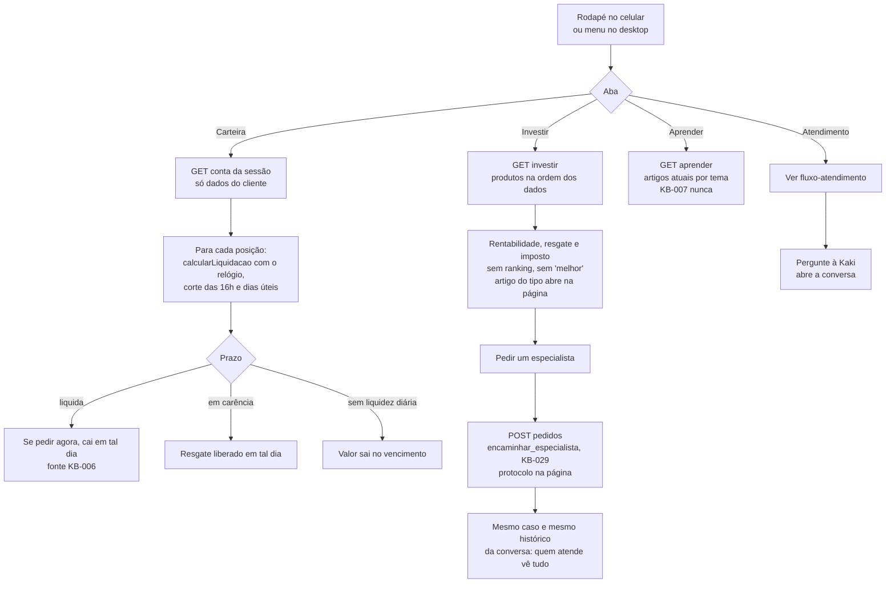

# Fluxo: páginas do cliente e rodapé de abas

O cliente navega por Início, Carteira, Investir, Aprender e Atendimento (Figma 50:202). Cada página responde com dados do servidor ou registra o pedido ali mesmo; a conversa fica dentro do Atendimento, como última alternativa (D16).

Referenciado em `../JORNADA_DO_USUARIO.pdf` (Páginas do cliente) e `bdd/paginas-do-cliente.feature`.
