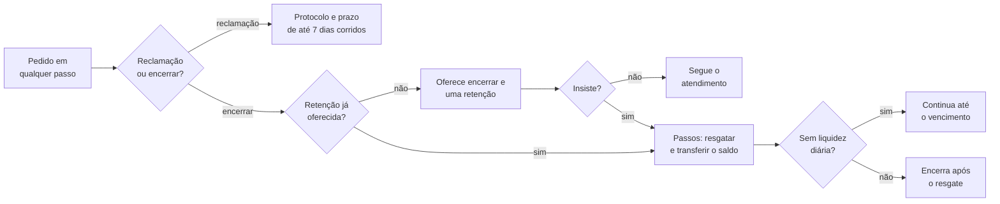

# Fluxo: reclamação e cancelamento

Reclamar ou encerrar a conta está disponível em qualquer passo, com no máximo uma tentativa de retenção.

O cliente não repete o motivo: ele já vai no resumo do caso.

Referenciado em `../JORNADA_DO_USUARIO.pdf` (reclamação e cancelamento) e `bdd/reclamacao-e-cancelamento.feature`.
