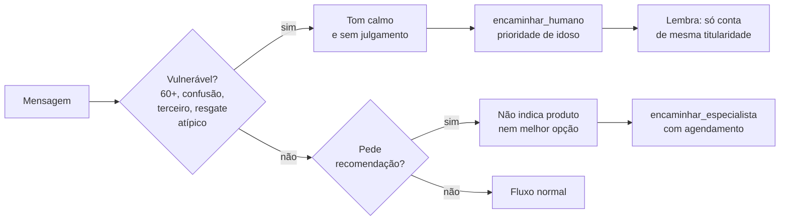

# Fluxo: recomendação e cliente vulnerável

A Camila pede para alguém dizer o que fazer; a Dona Marta recebe pressão de um terceiro. Nenhuma das duas recebe uma recomendação, e a Dona Marta passa na frente.

Pode explicar como os produtos funcionam, com fonte. Insistência ou troca de papel não mudam a ação.

Referenciado em `../JORNADA_DO_USUARIO.pdf` (jornada da Camila e da Dona Marta), `bdd/recomendacao.feature` e `bdd/cliente-vulneravel.feature`.
