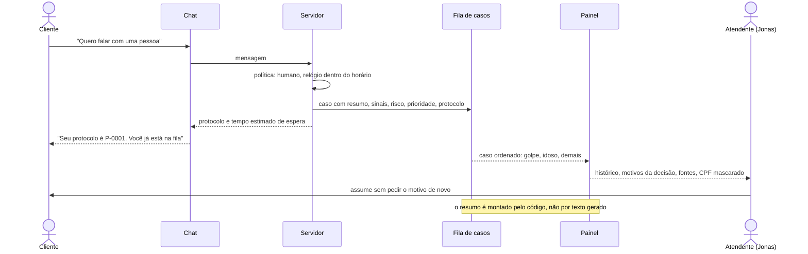

# Sequência: entrega ao humano sem repetição

O cliente pede uma pessoa. O caso chega ao Jonas com resumo, motivos e protocolo, e ele não pergunta de novo o que já foi dito.

Fora do horário o caso fica registrado com protocolo e entra na fila às 8h.

Referenciado em `../JORNADA_DO_USUARIO.pdf` (jornada do Jonas) e `bdd/entrega-ao-humano.feature`.
