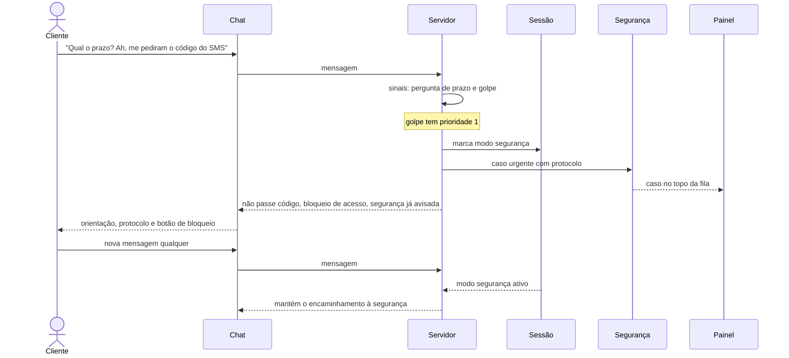

# Sequência: suspeita de golpe

O sinal de golpe interrompe tudo antes de qualquer outra resposta e atende a qualquer hora.

A pergunta original não é respondida antes. Fora do horário comercial o fluxo é o mesmo.

Referenciado em `../JORNADA_DO_USUARIO.pdf` (jornada de golpe) e `bdd/golpe.feature`.
