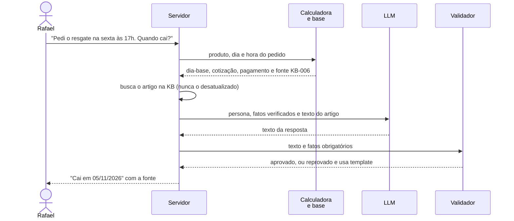

# Sequência: pergunta de prazo de resgate

O Rafael pergunta quando o resgate cai. O código calcula, o modelo só escreve, o validador confere.

Sem sinal de risco, a ação é responder. Se o LLM estiver fora do ar, o template entrega os mesmos fatos.

Referenciado em `../JORNADA_DO_USUARIO.pdf` (jornada do Rafael) e `bdd/liquidacao.feature`.
